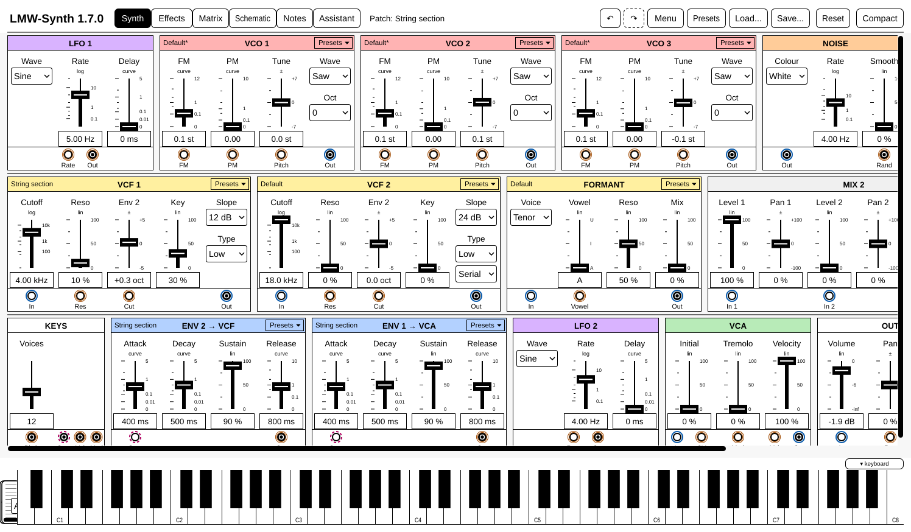

# LMW-Synth

A software synth with GUI and VST, using 9P for remote control.

A semi-modular polyphonic software synthesizer (standalone + VST3), C++20 / JUCE 9.
Licence: GNU AGPLv3 (see `LICENSE`). Design documents: `architecture/`.



More views: [Schematic](docs/images/schematic.png) (the whole patch as a drawing), [Matrix](docs/images/matrix.png) (every synth connection), [Effects](docs/images/effects.png) (COMB → ENSEMBLE → DELAY → REVERB, with their own matrix).

## Download

Releases (GitHub → Releases): LMW-Synth-<version>-setup.exe for Windows, -windows.zip, -macos.tar.gz, -ubuntu-24.04.tar.gz and -fedora-45.tar.gz, with SHA256SUMS.txt. The two newest releases are always kept; older ones are removed after 14 days (their tags stay, so every version can be rebuilt from source).

Every CI run (Actions tab → a green "build" run → Artifacts) offers LMW-Synth-ubuntu-24.04, -fedora-45, -macos and -windows: the standalone app, the LMW-Synth.vst3 plugin, the lmw9p client and docs/ (this read-me, the tutorial and the terms as web pages). Linux/macOS builds are a .tar.gz inside the zip. The builds are not code-signed, so Windows and macOS warn on first start. Install the plugin by copying LMW-Synth.vst3 to ~/.vst3 (Linux) or ~/Library/Audio/Plug-Ins/VST3 (macOS).

Windows: the -windows download also holds LMW-Synth-<version>-setup.exe. It installs the app (Start menu, with the tutorial, the terms and this read-me as web pages; Apps & features) and the VST3 plugin, either just for you (no administrator rights; the plugin goes to %LOCALAPPDATA%\Programs\Common\VST3, which some DAWs must be told to scan) or for all users (administrator rights; the plugin goes to C:\Program Files\Common Files\VST3, where every DAW looks). Running a newer setup updates LMW-Synth in place; uninstall in Settings → Apps. Patches and presets in Documents stay. The setup is not signed: SmartScreen asks first (More info → Run anyway). Silent: `LMW-Synth-<version>-setup.exe /S [/CURRENTUSER|/ALLUSERS]`.

## Tutorial
New to LMW-Synth? [docs/tutorial/Tutorial.md](docs/tutorial/Tutorial.md): twelve short lessons (the last one: the Assistant tab); in the app, Presets ▸ Tutorial sets each lesson's sound and puts its steps in the Notes tab. Unknown word? [docs/Terms.md](docs/Terms.md) explains the terms (VCO, cutoff, envelope, normalled, ...); in the app Menu ▸ Terms....

## AI assistant

**Assistant tab** (stand-alone program): ask questions or describe a sound in your own words, right inside the synth; Claude answers, changes the sound and plays a note so you hear it, with Undo last answer, Stop, the cost per answer and per session, and a spending limit (default $2 per session). It needs a Claude API key (a paid Anthropic account, a few cents per question): *Settings...* in the tab, with *How to get a key...* (tutorial Lesson 12). The key stays in the system keychain or, if you prefer, the settings file. Your questions and the current sound are sent to Anthropic; no audio, no other files.

**lmw-mcp** (for an assistant you already use, such as Claude Code or Claude Desktop):

`lmw-mcp` (in every download; on Windows tick "Command-line tools" in the installer) lets an AI assistant you are already logged in to set up sounds for you: "make a male ooo voice", "a breathy flute with a slow vibrato", "add a ping-pong echo". It is a Model Context Protocol server: the assistant starts it and it changes the running LMW-Synth over 9P. No API key, no network of its own; start LMW-Synth first.

- Claude Code: `claude mcp add lmw-synth -- /path/to/lmw-mcp`
- Claude Desktop (Settings → Developer → Edit config) or Gemini CLI (`~/.gemini/settings.json`):
  ```json
  { "mcpServers": { "lmw-synth": { "command": "/path/to/lmw-mcp" } } }
  ```
  On Windows the path is e.g. `C:\\Users\\you\\AppData\\Local\\Programs\\LMW-Synth\\lmw-mcp.exe` (backslashes doubled in JSON).

The assistant gets tools to read and set parameters and cables, apply presets, play notes to listen, name the sound and save it as your own instrument preset, and a sound-design guide ([docs/ai/SoundDesign.md](docs/ai/SoundDesign.md)). With several synths running it uses the newest, or the one you ask for.

## Prepare
```sh
scripts/prepare.sh            # lists the build dependencies and which are missing
scripts/prepare.sh --install  # installs the missing ones (apt, dnf or brew; asks for sudo)
scripts/prepare.sh --optional # also Xvfb, xdotool, ImageMagick (GUI checks) and podman (container build)
```
Ubuntu/Debian, Fedora and macOS; on Windows it names what to install (Visual Studio 2026 with C++, CMake, Git, NSIS).

## Build
```sh
cmake -B build -G Ninja -DCMAKE_BUILD_TYPE=Release
cmake --build build
ctest --test-dir build --output-on-failure
```
Standalone app: `build/LMWSynth_artefacts/Release/Standalone/`.

A binary only runs on Linux systems at least as new as the one that built it.
To build for **Ubuntu 24.04 and newer** from any Linux host (needs podman or docker):
```sh
scripts/build-ubuntu24.sh          # result in build-u24/Standalone and build-u24/VST3
scripts/build-ubuntu24.sh --clean  # full rebuild
scripts/validate-vst3.sh           # Steinberg validator + pluginval, built from source (after a build in build/)
scripts/pictures.sh                # retakes the README and tutorial pictures (Linux: Xvfb, ImageMagick; after a build)
```
