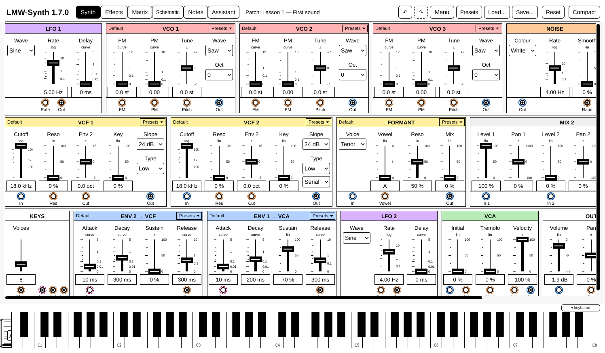
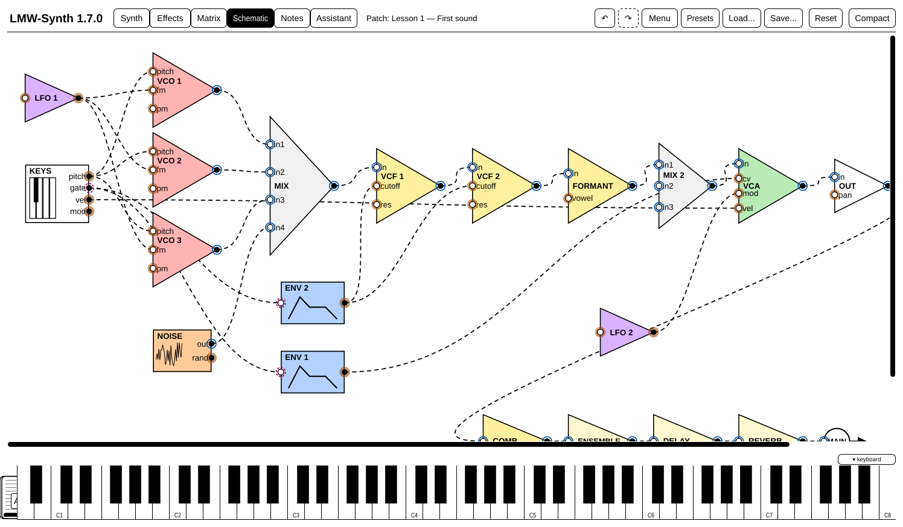
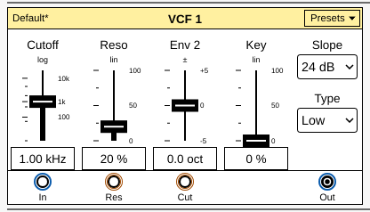
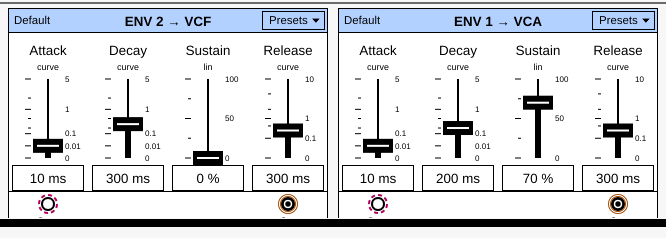
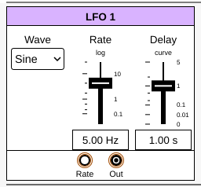
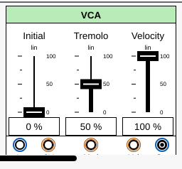
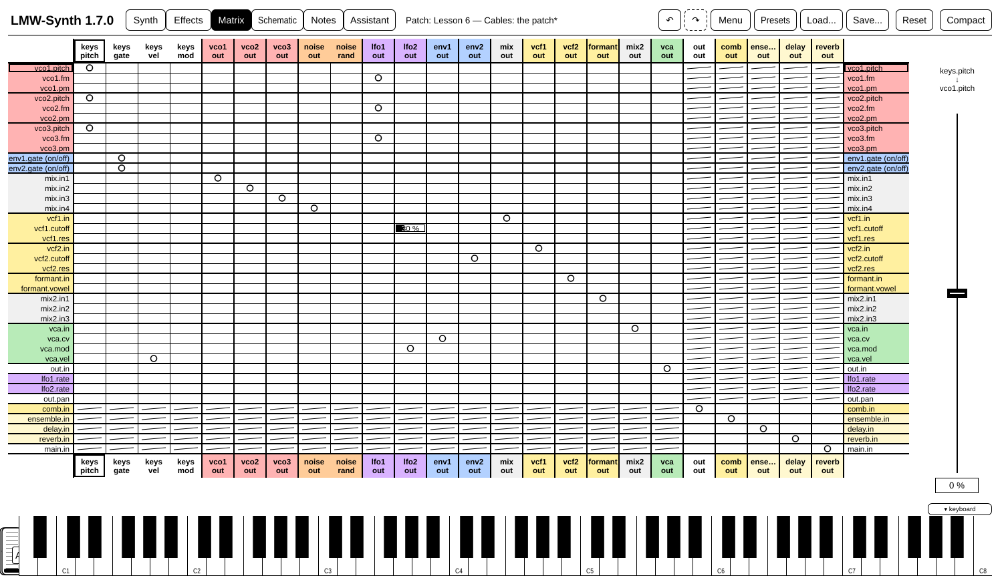
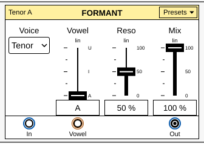
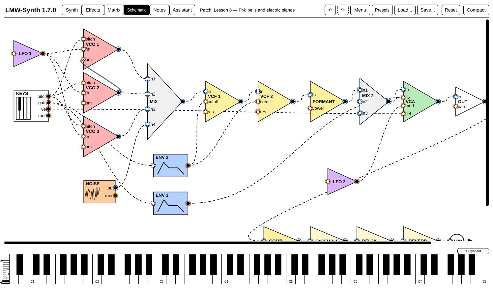
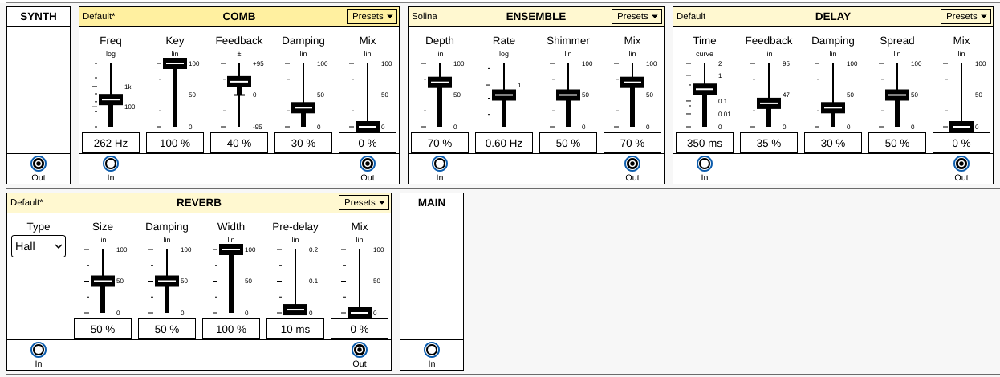

# LMW-Synth tutorial

Twelve short lessons, from the first note to remote control and the AI assistant. Each lesson starts from a **lesson sound**
(Presets ▸ Tutorial ▸ *Lesson n*), gives a few steps — *do this, listen for that* — and ends with
something to try on your own. A lesson takes 5 to 10 minutes. Lessons 1–4 are the basics; take the
others in any order.

Status: reviewed (2026-11-21). Screenshots: the *String section* preset.

**Words**: every term (VCO, cutoff, envelope, normalled, ...) is explained on the [Terms](../Terms.md)
page — also in the program, Menu › Terms... (with a Find field). A linked word below goes there.

**Conventions**
- Controls are written as *PANEL › Control*, e.g. *VCF 1 › Cutoff*.
- A cable is written *source → input*, e.g. *lfo2.out → vcf1.cutoff* (the names the Matrix tab uses).
- Double-click any fader to put it back to its default; hover over it for 2 s to see what it does,
  where its input comes from and its scale.
- Choosing a preset never touches your notes; the header shows *Patch: name\** once you have changed
  something since.

**Playing**: the on-screen keyboard (mouse), a MIDI keyboard, or the computer keyboard:
`a w s e d f t g y h u j k o l p ;` play C4 to E5 (the row `a s d f g h j k l ;` are the white keys).
The keys work whichever control you used last, except while you type a value.

---

## Lesson 1 — First sound

**Lesson sound:** *Default* (everything at its default; Volume −1.9 dB).



1. Play a few notes and a chord. You hear a plain sawtooth: bright, buzzy, with a short click-free
   start and a short release.
2. *KEYS › Voices*: drag it down to 1 and play a chord. Only the last note sounds: one voice, like a
   flute. Back to 8 (double-click): chords again.
3. *OUT › Volume*: the overall level. The output never clips hard: a soft limiter catches peaks.
4. Look at the tabs: **Synth** (the panels you see), **Effects**, **Matrix**, **Schematic**, **Notes**.
   Open **Schematic**: the whole instrument as a drawing, the sound flowing from left to right.



**Listen for:** the difference between one and eight voices.
**Try yourself:** hold a note and click *Compact* (top right): the same synthesizer, smaller.

---

## Lesson 2 — Oscillators: the raw sound

**Lesson sound:** *Lesson 2* — like Default, with *VCO 1 › Wave* on Saw and *ENV 1* sustain at 100 %
so a held note stays.

1. *VCO 1 › Wave*: try Sine (soft, flute-like), Triangle (a little brighter), Square (hollow,
   clarinet-like), Pulse (thin and nasal), Saw (bright, string- and brass-like).
2. *VCO 1 › Oct*: −1 and +1 move by octaves; *Tune* moves by semitones (±7).
3. *MIXER › VCO 2* up to 100 %: VCO 2 joins. Set *VCO 2 › Tune* to 0.08 (8 cents): the sound
   starts to move and get wider — **detune** ([tune](../Terms.md#tune)), the classic way to make one note sound like several.
4. *VCO 2 › Oct* +1 and *Tune* 0: an octave on top, organ-like. *VCO 2 › Tune* 7: a fifth.
5. *MIXER › Noise* to 10 %: a breath on top of the tone. *NOISE › Colour*: White, Pink (softer),
   Brown (darker).

**Listen for:** how much character the wave alone gives — before any filter.
**Try yourself:** VCO 1, 2 and 3 all on Saw, Tune 0, +0.1 and −0.08, mixer 100/80/60 %: a string
section from three oscillators.

---

## Lesson 3 — The filter: shaping the tone

**Lesson sound:** *Lesson 3* — VCO 1 Saw, *VCF 1 › Cutoff* 1 kHz, Reso 20 %.



1. Hold a note and move *VCF 1 › Cutoff* slowly from the top to the bottom: the sound goes from
   bright to dull, as if a hand covers a speaker. That is a **lowpass** filter (see [cutoff](../Terms.md#cutoff),
   [filter type](../Terms.md#filter-type)).
2. *Reso* up to 70 %: a whistling peak at the cutoff. Sweep the cutoff again: the classic "wow".
   Near the top the filter sings on its own.
3. *Type*: High (the low end disappears, thin), Band (only around the cutoff, telephone-like),
   Notch (a hole). *Slope*: 36 dB is the steepest, 6 dB gentle.
4. *VCF 1 › Key* 100 %: play low and high notes. The cutoff now follows the keys, so high notes are
   as bright as low ones — as on real instruments.
5. *VCF 2*: a second filter after the first. Set it to High, Cutoff 300 Hz: VCF 1 removes the top,
   VCF 2 the bottom. The box under *VCF 2 › Type* says Serial; set it to Parallel: both filters get the mixer and are mixed 50/50.

**Listen for:** the cutoff decides "bright or dark", resonance "neutral or vocal".
**Try yourself:** VCF 1 Low 24 dB at 500 Hz, Reso 75 %: a squelchy acid bass (play low notes).

---

## Lesson 4 — Envelopes: how a note starts and ends

**Lesson sound:** *Lesson 4* — VCO 1 Saw, *VCF 1 › Cutoff* 600 Hz, *VCF 1 › Env 2* +3 oct.

**ENV 1** shapes the loudness (it drives the [VCA](../Terms.md#vca)), **ENV 2** the filter (it drives the cutoff, by the
*Env 2* fader of each VCF). Each [envelope](../Terms.md#envelope) has Attack, Decay, Sustain, Release ([ADSR](../Terms.md#adsr)):
attack = time to rise, decay = time to fall to the sustain level, release = time to die away after
the key is let go.



1. *ENV 1 › Attack* 1 s: notes swell in, like strings. Back to 10 ms.
2. *ENV 1 › Sustain* 0 %, *Decay* 400 ms: a pluck. *Release* 1 s: it rings on after the key.
3. Now the filter: *ENV 2 › Decay* 300 ms, *Sustain* 0 %. Each note starts bright and closes: the
   brightness moves, not only the loudness. Try *VCF 1 › Env 2* at −2 oct: opening instead of closing.
4. Choose *ENV 1 › Presets › Piano*, then *Pad (slow)*: the panel's presets set all four faders at
   once; the title bar shows the preset name, with "\*" once you change a fader.

**Listen for:** a pluck has a fast attack and no sustain; a pad a slow attack and long release.
**Try yourself:** ENV 1 attack 5 ms, decay 1 s, sustain 0; ENV 2 the same: a plucked string.

---

## Lesson 5 — Movement: vibrato and tremolo

**Lesson sound:** *Lesson 5* — VCO 1 Sine, ENV 1 sustain 100 %.

1. *VCO 1 › FM* to 0.3 st: [vibrato](../Terms.md#vibrato). **LFO 1** (a slow oscillator, an [LFO](../Terms.md#lfo)) is connected to the FM inputs of
   all three VCOs; the FM fader sets how much. The mod wheel of a MIDI keyboard adds to it.
2. *LFO 1 › Rate*: 5–6 Hz is a singer's vibrato; 0.5 Hz a slow drift; 15 Hz a nervous warble.
   *LFO 1 › Wave* Square: a trill between two pitches.
3. *LFO 1 › Delay* to 1 s and play long notes: each note starts plain and the vibrato comes in after it
   ([delayed vibrato](../Terms.md#delayed-vibrato)), as a singer or violinist does: nothing for the first
   half second, then it fades in, full at 1 s. The delay counts **per note**: in a chord every note fades in
   from its own start. The LFO itself keeps running; what is delayed is how much of it each note gets —
   wherever LFO 1 goes into a voice (the VCOs' FM, a VCF, the VCA, any cable from *lfo1.out* to a voice).
   A cable from LFO 1 straight to OUT, or to an LFO's Rate, is **not** delayed: there the LFO is used once
   for all notes together (their hover text says so). The Schematic shows "delay 1.00 s" under LFO 1, and
   the hover texts of the sockets it feeds say "delayed". Set it back to 0 s.

   

4. *VCA › Tremolo* to 50 %: the loudness pulses ([tremolo](../Terms.md#tremolo)). That is **LFO 2**, connected to the VCA's Mod input.

   

5. *LFO 2 › Rate* 25 Hz, *Tremolo* 80 %: a growl; on a vowel (lesson 7) this becomes a rolled "rrr".
6. The LFO's speed can be changed by a signal too: Lesson 6 shows how, with a cable from ENV 2 to
   *LFO 1 › Rate*, so the vibrato speeds up while a note is held.

**Listen for:** vibrato moves pitch, tremolo moves loudness.
**Try yourself:** a slow LFO 1 (0.3 Hz) with *VCO 2 › FM* 0.15 and VCO 2 mixed in: a gently drifting pad.

---

## Lesson 6 — Cables: the patch

**Lesson sound:** *Lesson 6* — like Lesson 3 (filtered saw), Cutoff 800 Hz.

LMW-Synth is **[semi-modular](../Terms.md#semi-modular)**: everything is already connected ("[normalled](../Terms.md#normalled)", the dashed lines in the
Schematic), and a cable replaces a normal connection where you want something else.

1. Sockets are under the panels: white = input, black = output. The ring around each tells the kind of
   signal it is made for: solid blue = audio (sound), double orange = control voltage (a signal that moves a
   setting, like an LFO or an envelope), dashed magenta = gate (on / off); the hover text says it too, and
   the Schematic has a legend. Any output may still go to any input — a VCO on another VCO's FM is FM
   synthesis. Drag from *LFO 2 › Out* to *VCF 1 › Cut* (the cutoff input). The filter now wobbles with LFO 2 instead of following ENV 2.
2. Open the **Matrix** tab: every input is a row, every output a column. The cable is a filled cell
   at 100 %. Click the cell (that only selects it) and drag up/down, or use the slider on the right:
   set it to 30 %. A click on an empty cell makes a cable at 100 %, a double-click removes a cable, and
   right-click opens a small menu (100 %, Type level..., Remove cable). A ring in a cell shows a normal
   connection, used while that input has no cable.

   

3. Cables add up: in the Matrix also set *env2.out × vcf1.cutoff* to 100 %: envelope **and** wobble.
4. Back on **Synth**: drag the cable's plug from *VCF 1 › Cut* into empty space to remove it.
   Right-click (or Tab to a socket and press Enter) for a menu of connections. At its bottom every
   connection of that socket has a fader: drag it to change the level while you listen (*Type a level*
   in the same menu does it without a mouse).
5. *ENV 2 › Out* → *LFO 1 › Rate*, *VCO 1 › FM* 0.3 st: the vibrato speeds up as a note is held.
6. **Schematic** tab: cables are solid lines, normal connections dashed; you can patch there too.

**Listen for:** a cable on an input switches off its normal source — unplug it and the default returns.
**Try yourself:** *noise.rand* (the random steps of NOISE) → *vcf1.cutoff* at 40 %: the classic
"sample & hold" bleeps.
**Inverted:** right-click *VCF 1 › Cut* and drag the *env2.out* fader below 0 (to −50 %): the
envelope now closes the filter as it rises. Modulation inputs take −100 … +100 %; *keys.pitch* at
−30 % on *VCA › Mod* makes low notes louder.

---

## Lesson 7 — Voices: vowels with FORMANT

**Lesson sound:** *Lesson 7* — VCO 1 Pulse, VCO 2 Saw (+0.1) at 70 %, FORMANT Mix 100 %, Voice Tenor.



1. *FORMANT › Vowel*: slide from A to U and play. The filter shapes the sound like a mouth ([formant](../Terms.md#formant)): aa, ee,
   ii, oo, uu, gliding in between.
2. *FORMANT › Voice*: Bass, Baritone, Tenor, Alto, Sopr(ano), Child — the vowels move up.
3. *FORMANT › Reso*: higher is more pronounced, lower more natural.
4. A vowel that moves: in the **Matrix**, set *lfo2.out × formant.vowel* to **10 %** (100 % would swing
   over all vowels): a slow "aa-ee-aa". *LFO 2 › Rate* 0.5 Hz.
5. Try *Presets* (top) › *Choir (aah)* and *Male voice (ooo)*.

**Listen for:** a bright source (Pulse, Saw) gives clear vowels; a sine has nothing to shape.
**Try yourself:** Voice Baritone, Vowel O, LFO 2 at 25 Hz with *VCA › Tremolo* 60 %: a rolled "rrr".

---

## Lesson 8 — FM: bells and electric pianos

**Lesson sound:** *Lesson 8* — VCO 1 and VCO 2 Sine, VCO 2 not in the mixer, cable *vco2.out → vco1.pm*.

**Phase modulation** ([PM](../Terms.md#pm); called FM on DX synthesizers, see [FM](../Terms.md#fm)): one oscillator wobbles the phase of another so fast
that you hear new overtones instead of vibrato.



1. *VCO 1 › PM* from 0 up to 2: the plain sine gets brighter and brighter. The fader is the
   **index**; the lower half of its travel (0–2) is the most musical.
2. *VCO 2 › Oct* +1: a different, bell-like set of overtones. *VCO 2 › Tune* 3.5 or 7: metallic.
3. *ENV 1* as in *Piano* (fast attack, long decay, no sustain): an electric piano.
4. **Feedback**: remove the cable, then *vco1.out → vco1.pm* and PM 1.5: the sine turns into a buzzy,
   saw-like tone.
5. The PM violin: *lfo1.out* into all three PM inputs, PM 0.6 on VCO 1 and 2, Saw waves — see
   *Presets › Violin (PM vibrato)*.

**Listen for:** FM gives brightness without a filter; index and ratio change the character a lot.
**Try yourself:** *Presets › Electric piano (FM)* and raise *VCO 1 › PM* step by step.

---

## Lesson 9 — Effects: comb, ensemble, delay and reverb

**Lesson sound:** *Lesson 9* — *Flute* without its comb and reverb (all effect Mix faders at 0).

The **Effects** tab: SYNTH (the instrument) → COMB → ENSEMBLE → DELAY → REVERB → MAIN (what you
hear), connected by default; [Mix](../Terms.md#mix) 0 means an [effect](../Terms.md#effect) is off. In a narrow window REVERB and MAIN wrap to
a second row. Drag an effect's title left or right to change the order: the connections follow (e.g. REVERB
first, then COMB, rings the comb on the reverb's tail).



1. *REVERB › Mix* 25 %, *Size* 80 %: a hall. *Damping* darker, *Width* narrower or wider, *Pre-delay*
   30 ms: the flute stays clear in front of the hall. *Type* Classic is the reverb of older versions.
2. *COMB › Mix* 30 %, *Key* 100 %, *Freq* 262 Hz (C4), *Feedback* 40 %: a resonant body that
   follows the notes — the breathy flute gets a tube.
3. *COMB › Feedback* −50 %: odd harmonics, clarinet-like. *Damping* softens it. Back to *COMB › Mix* 0.
4. *Presets › String section*, then *ENSEMBLE › Mix* 0 and back to 70 %: the string-machine chorus
   (as in the Solina; [ENSEMBLE](../Terms.md#ensemble)) that makes the saws wide and moving. *Depth*: how far it sweeps; *Shimmer*: the
   fast trembling; *Rate*: both sweeps faster or slower. *ENSEMBLE › Presets › Wide* or *Subtle chorus*.
5. *DELAY › Mix* 30 %, *Time* 350 ms, *Feedback* 40 %: echoes. *Spread* 100 %: they bounce between
   left and right (ping-pong). *Damping*: each echo darker.
6. Hold a note and move *DELAY › Time* while the echoes ring: their pitch bends, like a tape
   machine slowing down — the "dynamic" delay.
7. Order with cables: on the Effects tab, *SYNTH › Out* → *REVERB › In*, *REVERB › Out* →
   *COMB › In*, *COMB › Out* → *MAIN › In*: now the comb colours the reverb too (ensemble and delay are
   out of the chain until you patch them back).
8. **Stereo**: on the Synth tab, *OUT › Spread* 60 % (the box under it: Keys) and play a chord across the
   keyboard: low notes come from the left, high notes from the right, as on a piano — each voice gets its
   own place before the effects, so the reverb and delay sound wider ([spread](../Terms.md#spread)). Set the box to
   Voices with *KEYS › Voices* 6: even one note played twice moves. *OUT › Pan* moves the whole sound
   ([pan](../Terms.md#pan)); a cable from *LFO 2 › Out* to *OUT › Pan* makes it wander (auto-pan).
   One voice can be stereo too: **MIX 2** (after the filters) has a Pan for each input — *Presets › Choral
   flute* sends VCO 1 through VCF 1 to the left and VCO 2 through VCF 2 to the right
   ([MIX 2](../Terms.md#mix-2)).

Each effect has its own **Presets** in its title bar, e.g. *DELAY › Presets › Ping-pong* or
*COMB › Presets › Hollow tube*.

**Listen for:** COMB is tied to the pitch (with Key), DELAY to time, REVERB to the room.
**Try yourself:** COMB Key 0 %, Freq 100 Hz, Feedback 90 %: a metallic, flanger-like ring; DELAY
Time 30 ms, Feedback 70 %: a short metallic repeat (a slap echo).

---

## Lesson 10 — Presets and patches

**Lesson sound:** *Clarinet*.

1. *Presets* (header) › *Clarinet*: a whole sound — modules, voices (1), comb, reverb. Look at the
   panels: VCO 1, VCF 1, ENV 1 and ENV 2 show "Clarinet" in their title bars; on the Effects tab
   COMB shows "Clarinet" and REVERB "Chamber".
2. Change *VCF 1 › Cutoff*: the header says *Patch: Clarinet\**, the VCF 1 title *Clarinet\**.
3. *Module presets*: *VCF 1 › Presets › Oboe* changes only that filter.
4. *Presets › Save as instrument preset…*: your sound, under *Your presets* from now on.
   *Save…* writes a patch file (with your notes); *Load…* reads one. Both are plain text you can
   open in an editor.
5. The **Notes** tab: write what you did; it is saved with the patch.

**Listen for:** "\*" means "changed since" — nothing is lost until you choose another preset.
**Try yourself:** start from *Default* and build your own flute with lessons 2–9; save it.

---

## Lesson 11 — Advanced: remote control over 9P

**Lesson sound:** any.

LMW-Synth is also a small file server (the **9P** protocol): every parameter, the cables, the notes
and the keys are files. Tools and other programs (such as the Kukel GUI, or an AI assistant later)
use it to control the synth.

1. Hover over the title *LMW-Synth* (top left): the hover text gives the address, e.g.
   `unix!/run/user/1000/lmw-synth/12345-1.sock`.
2. In a terminal, with the `lmw9p` tool that comes with LMW-Synth:
   ```sh
   lmw9p unix!/run/user/1000/lmw-synth/12345-1.sock ls params
   lmw9p unix!/run/user/1000/lmw-synth/12345-1.sock cat params/vcf1/cutoff
   lmw9p unix!/run/user/1000/lmw-synth/12345-1.sock write params/vcf1/cutoff 800
   ```
   The fader moves as you write.
3. Cables: `write cables "vcf1.cutoff=lfo2.out@0.3"`; `cat cables` lists them; `cat ports` shows every
   socket and its normal source.
4. Play: `write keys "on 60 100"` and `write keys "off 60"`.
5. `cat info` lists every parameter with its range and unit (JSON); `cat serial` changes whenever
   anything changes — a client polls it to know when to read again.

**Listen for:** the synth reacts at once; the GUI and 9P are two views of the same instrument.
**Try yourself:** a small shell loop that writes a new cutoff every 0.2 s — your own LFO.

---

## Lesson 12 — The assistant: describe a sound in words

**Lesson sound:** any. The *Assistant* tab is in the stand-alone program (not in the plug-in).

In the *Assistant* tab you ask questions about the synth or describe the sound you want, in your own
words; an AI model (Claude, by Anthropic) answers, changes the sound and plays a note so you hear it.
It needs a **Claude API key**: a paid account at Anthropic. A question costs well under a cent with the
default model (a few cents with the bigger ones); the tab shows what each answer and the whole session cost.

1. Get a key (once): open the Claude Console at https://platform.claude.com in your browser, sign
   up (or log in), add a little credit under *Billing* (for example $5), then under *API keys* choose
   *Create key*, give it a name such as *LMW-Synth* and copy the key (it starts with `sk-ant-`). The
   Console shows it only once: keep it somewhere safe, it works like a password.
2. In LMW-Synth: the *Assistant* tab › *Settings...* (also *Menu* › *Assistant settings...*). Press
   *Paste*, then *Test connection*: it should say *the key works*.
3. Choose where the key is kept: *the system keychain* (safest) or *the settings file* (simplest,
   plain text). *Model* starts at Claude Haiku 5.5, the cheapest; choose Sonnet or Opus for more
   careful sound design at a higher price. The *Spending limit* (default $2 per session) makes it ask before going on. Press *OK*.
4. Type a wish, e.g. *a soft flute with a slow vibrato*, and press Enter. Grey lines show each change
   (*set vcf1.cutoff 800*, *played C4 for 2 s*).
5. Not what you wanted? Say so (*less vibrato, a bit brighter*), or press *Undo last answer* to put the
   sound back. *Stop* ends an answer that runs too long.
6. Like it? Ask *save it as My flute*: the synth asks you first, then it appears under *Presets* ›
   *Your presets*, also in the plug-in.

**Good to know:** your questions, the answers and the current sound (parameters, cables, name and
notes) are sent to Anthropic to be answered; no audio, no other files.
**Try yourself:** ask *why does my sound click at the start of a note?* with a sound that clicks.

---

## Lesson sounds (for the implementation)

| Preset | Based on | Changes |
|---|---|---|
| Lesson 2 | Default | env1.sustain 1 |
| Lesson 3 | Default | vcf1.cutoff 1000, vcf1.res 0.2 |
| Lesson 4 | Default | vcf1.cutoff 600, vcf1.env 3 |
| Lesson 5 | Default | vco1.wave Sine, env1.sustain 1 |
| Lesson 6 | Lesson 3 | vcf1.cutoff 800 |
| Lesson 7 | Default | vco1.wave Pulse, vco2.wave Saw, vco2.tune 0.1, mix.vco2 0.7, formant.mix 1, formant.voice Tenor |
| Lesson 8 | Default | vco1.wave Sine, vco2.wave Sine, mix.vco2 0, env1.sustain 1, vco1.pm 0; cable vco1.pm = vco2.out |
| Lesson 9 | Flute | comb.mix 0, reverb.mix 0 (delay.mix is 0 already) |

Lessons 1, 10, 11 and 12 use existing presets (Default, Clarinet, any, any). Each lesson preset carries its
lesson's steps in the Notes text. Choosing a preset normally keeps your notes (S7.7); the lesson
presets are the one exception (user 2026-11-21): they replace the notes with the lesson's steps,
headed "Tutorial lesson n — from docs/tutorial/Tutorial.md".
